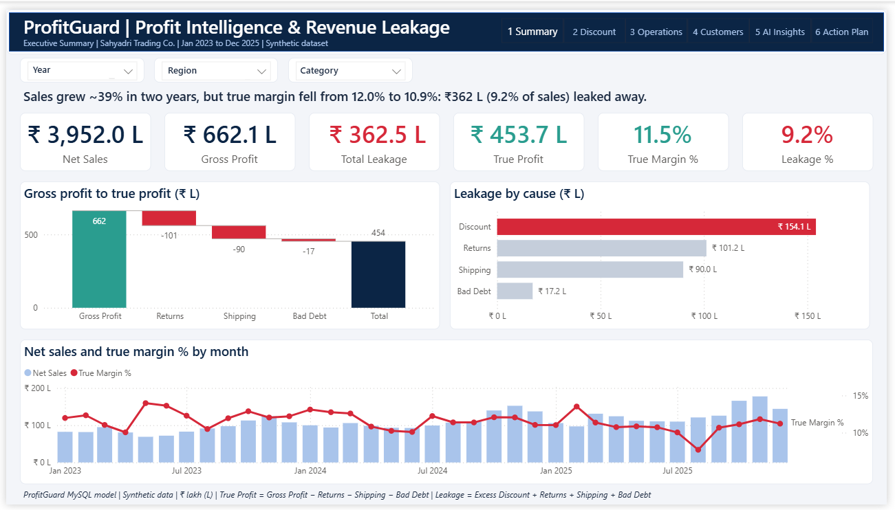
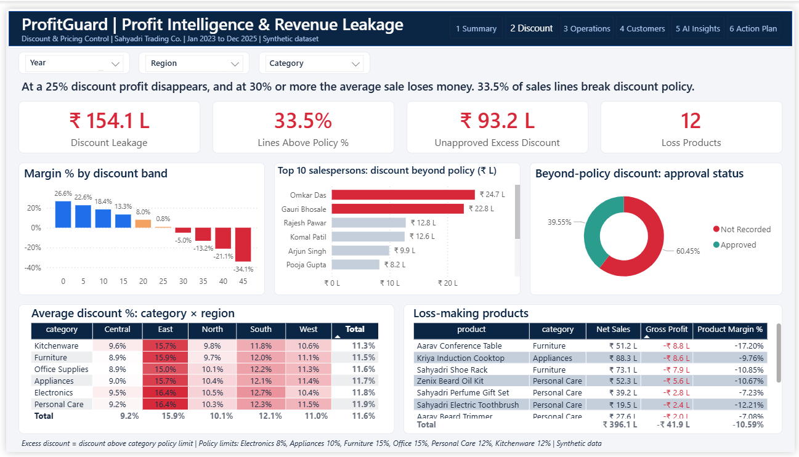
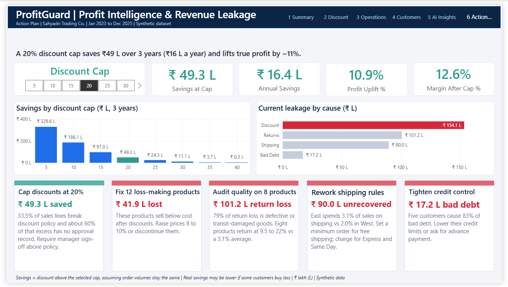

# ProfitGuard: Profit Intelligence & Revenue Leakage Detection

An end-to-end profit analytics project using **MySQL** and **Power BI**. It finds where a retail business loses money and shows how much a discount policy would save.





> **Note:** The data is **synthetic** (computer-generated) and built for practice. Names and numbers are not real.

## Business problem
A retail distributor (Sahyadri Trading Co., 11,000 orders, Jan 2023 to Dec 2025) grew sales ~39% in two years, but its true margin fell. Where is the money leaking?

## Key findings
- Total leakage: **₹362 L (9.2% of sales)** from excess discounts, returns, shipping and bad debt
- True margin falls from **16.8% to 11.5%** once leakage is counted
- Discounts of **35% or more** make a sale about **6x more likely to lose money**
- **12 products** sell below cost (₹41.9 L lost)
- 79% of return loss comes from defective or transit-damaged goods
- **5 customers** cause 83% of bad debt
- A **20% discount cap** would save about **₹49 L (+11% profit)**

## Tech stack
MySQL 8, MySQL Workbench, Power BI Desktop, DAX

## Approach
1. **Data cleaning (SQL):** removed duplicates, fixed invalid dates, handled blanks
2. **Star schema:** fact and dimension tables, plus 5 views
3. **Leakage definitions:** excess discount (above category policy), return loss, unrecovered shipping, bad debt (written-off orders)
4. **SQL techniques:** CTEs, window functions (NTILE, RANK), joins, views
5. **Power BI:** star-schema model, DAX measures, what-if parameter, Key Influencers, forecasting, anomaly detection, decomposition tree

## Dashboard pages
| Page | Question answered |
|---|---|
| 1 Summary | How much money leaks? |
| 2 Discount | At what discount do we lose money? |
| 3 Operations | Returns, shipping, bad debt |
| 4 Customers | RFM, churn, Pareto, low-margin big accounts |
| 5 AI Insights | Key drivers, forecast, anomalies |
| 6 Action Plan | What to do and how much it saves |








## Recommendations
Cap discounts at 20% with manager approval, fix or drop 12 loss-making products, audit quality on 8 high-return products, rework shipping rules, tighten credit control.

## Assumptions and limitations
- Synthetic data
- Savings assume order volumes stay the same, so real savings may be lower
- Churn = no order in the last 180 days (as of 31 Dec 2025)

## Repository structure
```
dashboard_screenshots/        01_summary.png, 02_discount.png, 03_oprations.png, 04_customers.png, 05_ai_insights.png, 06_action_plan.png,
docs/                         er_diagram, model_view
sql/                          01_staging_and_cleaning, 02_start_schema, 03_views, 04_leakage_queries
```

## Author
Tanmay Pande |LinkedIn link - https://www.linkedin.com/in/tanmay-pande-5558202b9 | tanmaypande321@gmail.com
